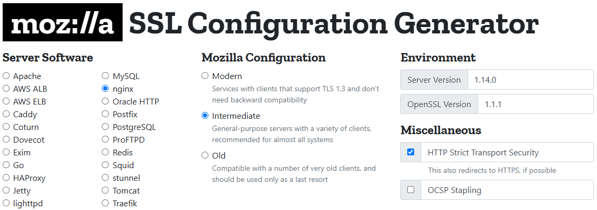

# CRY Labo 4

## 1. Pourquoi devons nous transmettre une chaine de certificats dans les deux applications (email et TLS) ?

Parce que la plupart des clients (navigateur, client mail, etc.) ne connaissent que les certificats racines, pas les intermédiaires. Sans la chaîne de certificats, le navigateur ne peut pas vérifier que le serveur est légitime et le client mail ne peut pas vérifier la signature du mail.

## 2. Comment avez-vous configuré nginx ? Donnez votre fichier de configuration.

J'ai utilisé l'[outil de Mozilla](https://ssl-config.mozilla.org/#server=nginx&version=1.14.0&config=intermediate&openssl=1.1.1&ocsp=false&guideline=5.7) qui permet de générer une configuration de base pour nginx. Voici les paramètres que j'ai utilisés :



Et voici le fichier de configuration :

```
# generated 2025-06-05, Mozilla Guideline v5.7, nginx 1.14.0 (UNSUPPORTED; end-of-life), OpenSSL 1.1.1 (UNSUPPORTED; end-of-life), intermediate config, no OCSP
# https://ssl-config.mozilla.org/#server=nginx&version=1.14.0&config=intermediate&openssl=1.1.1&ocsp=false&guideline=5.7

server {
    listen 443 ssl http2;
    listen [::]:443 ssl http2;
    ssl_certificate /etc/nginx/sites-available/chain.crt;
    ssl_certificate_key /etc/nginx/sites-available/IP.key;

    # HSTS (ngx_http_headers_module is required) (63072000 seconds)
    add_header Strict-Transport-Security "max-age=63072000" always;

    # intermediate configuration
    ssl_protocols TLSv1.2 TLSv1.3;
    ssl_ecdh_curve X25519:prime256v1:secp384r1;
    ssl_ciphers ECDHE-ECDSA-AES128-GCM-SHA256:ECDHE-RSA-AES128-GCM-SHA256:ECDHE-ECDSA-AES256-GCM-SHA384:ECDHE-RSA-AES256-GCM-SHA384:ECDHE-ECDSA-CHACHA20-POLY1305:ECDHE-RSA-CHACHA20-POLY1305:DHE-RSA-AES128-GCM-SHA256:DHE-RSA-AES256-GCM-SHA384:DHE-RSA-CHACHA20-POLY1305;
    ssl_prefer_server_ciphers off;

    # see also ssl_session_ticket_key alternative to stateful session cache
    ssl_session_timeout 1d;
    ssl_session_cache shared:MozSSL:10m;  # about 40000 sessions
    ssl_session_tickets off;

    # curl https://ssl-config.mozilla.org/ffdhe2048.txt > /path/to/dhparam
    ssl_dhparam /etc/nginx/sites-available/dh;
}


# HSTS
server {
    listen 80 default_server;
    listen [::]:80 default_server;

    return 301 https://$host$request_uri;
}
```

## 3. Fournissez le résultat du scan de testssl sur votre serveur ainsi que des commentaires, si nécessaire.

**Commentaire** : j'ai utilisé l'IP à la place du nom de domaine dans le fichier de configuration fourni.

```
#####################################################################
  testssl.sh version 3.2.0 from https://testssl.sh/
  (fbbf688 2025-05-28 20:16:32)

  This program is free software. Distribution and modification under
  GPLv2 permitted. USAGE w/o ANY WARRANTY. USE IT AT YOUR OWN RISK!

  Please file bugs @ https://testssl.sh/bugs/
#####################################################################

  Using OpenSSL 3.5.0 (May 2 2025)  [~96 ciphers]
  on DESKTOP-ULG30VV:/home/livex/miniforge3/bin/openssl

 Start 2025-06-10 15:16:15        -->> 10.190.133.59:44327 (10.190.133.59) <<--

 rDNS (10.190.133.59):   --
 Service detected:       HTTP

 Testing protocols via sockets except NPN+ALPN

 SSLv2      not offered (OK)
 SSLv3      not offered (OK)
 TLS 1      not offered
 TLS 1.1    not offered
 TLS 1.2    offered (OK)
 TLS 1.3    offered (OK): final
 NPN/SPDY   h2, http/1.1 (advertised)
 ALPN/HTTP2 h2, http/1.1 (offered)

 Testing cipher categories

 NULL ciphers (no encryption)                      not offered (OK)
 Anonymous NULL Ciphers (no authentication)        not offered (OK)
 Export ciphers (w/o ADH+NULL)                     not offered (OK)
 LOW: 64 Bit + DES, RC[2,4], MD5 (w/o export)      not offered (OK)
 Triple DES Ciphers / IDEA                         not offered
 Obsoleted CBC ciphers (AES, ARIA etc.)            not offered
 Strong encryption (AEAD ciphers) with no FS       not offered
 Forward Secrecy strong encryption (AEAD ciphers)  offered (OK)


 Testing server's cipher preferences

Hexcode  Cipher Suite Name (OpenSSL)       KeyExch.   Encryption  Bits     Cipher Suite Name (IANA/RFC)
-----------------------------------------------------------------------------------------------------------------------------
SSLv2
 -
SSLv3
 -
TLSv1
 -
TLSv1.1
 -
TLSv1.2 (no server order, thus listed by strength)
 xc030   ECDHE-RSA-AES256-GCM-SHA384       ECDH 253   AESGCM      256      TLS_ECDHE_RSA_WITH_AES_256_GCM_SHA384        
 x9f     DHE-RSA-AES256-GCM-SHA384         DH 2048    AESGCM      256      TLS_DHE_RSA_WITH_AES_256_GCM_SHA384          
 xcca8   ECDHE-RSA-CHACHA20-POLY1305       ECDH 253   ChaCha20    256      TLS_ECDHE_RSA_WITH_CHACHA20_POLY1305_SHA256  
 xccaa   DHE-RSA-CHACHA20-POLY1305         DH 2048    ChaCha20    256      TLS_DHE_RSA_WITH_CHACHA20_POLY1305_SHA256    
 xc02f   ECDHE-RSA-AES128-GCM-SHA256       ECDH 253   AESGCM      128      TLS_ECDHE_RSA_WITH_AES_128_GCM_SHA256        
 x9e     DHE-RSA-AES128-GCM-SHA256         DH 2048    AESGCM      128      TLS_DHE_RSA_WITH_AES_128_GCM_SHA256          
TLSv1.3 (no server order, thus listed by strength)
 x1302   TLS_AES_256_GCM_SHA384            ECDH 253   AESGCM      256      TLS_AES_256_GCM_SHA384                       
 x1303   TLS_CHACHA20_POLY1305_SHA256      ECDH 253   ChaCha20    256      TLS_CHACHA20_POLY1305_SHA256                 
 x1301   TLS_AES_128_GCM_SHA256            ECDH 253   AESGCM      128      TLS_AES_128_GCM_SHA256                       

 Has server cipher order?     no
 (limited sense as client will pick)

 Testing robust forward secrecy (FS) -- omitting Null Authentication/Encryption, 3DES, RC4

 FS is offered (OK)           TLS_AES_256_GCM_SHA384 TLS_CHACHA20_POLY1305_SHA256 ECDHE-RSA-AES256-GCM-SHA384
                              DHE-RSA-AES256-GCM-SHA384 ECDHE-RSA-CHACHA20-POLY1305 DHE-RSA-CHACHA20-POLY1305
                              TLS_AES_128_GCM_SHA256 ECDHE-RSA-AES128-GCM-SHA256 DHE-RSA-AES128-GCM-SHA256
 Elliptic curves offered:     prime256v1 secp384r1 X25519
 DH group offered:            ffdhe2048
 TLS 1.2 sig_algs offered:    RSA-PSS-RSAE+SHA512 RSA-PSS-RSAE+SHA384 RSA-PSS-RSAE+SHA256 RSA+SHA512 RSA+SHA384
                              RSA+SHA256 RSA+SHA224 RSA+SHA1
 TLS 1.3 sig_algs offered:    RSA-PSS-RSAE+SHA512 RSA-PSS-RSAE+SHA384 RSA-PSS-RSAE+SHA256

 Testing server defaults (Server Hello)

 TLS extensions (standard)    "max fragment length/#1" "EC point formats/#11"
                              "application layer protocol negotiation/#16" "extended master secret/#23"
                              "supported versions/#43" "key share/#51" "next protocol/#13172"
                              "renegotiation info/#65281"
 Session Ticket RFC 5077 hint no -- no lifetime advertised
 SSL Session ID support       yes
 Session Resumption           Tickets no, ID: yes
 TLS clock skew               Random values, no fingerprinting possible
 Certificate Compression      none
 Client Authentication        none
 Signature Algorithm          SHA256 with RSA
 Server key size              RSA 3072 bits (exponent is 65537)
 Server key usage             Digital Signature, Key Encipherment
 Server extended key usage    TLS Web Server Authentication, TLS Web Client Authentication
 Serial                       7FD7549A66251A60FDA44D7477C72C60BB3DCBB7 (OK: length 20)
 Fingerprints                 SHA1 13028012036DF94209E0A11F9AC06EB790C43CBA
                              SHA256 B6D387B67C5DA38779CE5BFECC87B50B8305ACE0BDD4A2D03A60B85002914326
 Common Name (CN)             Certificat IP
 subjectAltName (SAN)         10.190.133.59
 Trust (hostname)             Ok via SAN
 Chain of trust               Ok
 EV cert (experimental)       no
 Certificate Validity (UTC)   392 >= 60 days (2025-06-04 17:15 --> 2026-07-07 17:15)
 ETS/"eTLS", visibility info  not present
 Certificate Revocation List  --
 OCSP URI                     --
                              NOT ok -- neither CRL nor OCSP URI provided
 OCSP stapling                not offered
 OCSP must staple extension   --
 DNS CAA RR (experimental)    not offered
 Certificate Transparency     --
 Certificates provided        2
 Issuer                       Oliveira-TLS (HEIG-VD from CH)
 Intermediate cert validity   #1: ok > 40 days (2035-06-04 17:09). Oliveira-TLS <-- HEIG-VDRoot
 Intermediate Bad OCSP (exp.) Ok


 Testing HTTP header response @ "/"

 HTTP Status Code             200 OK
 HTTP clock skew              0 sec from localtime
 Strict Transport Security    730 days=63072000 s, just this domain
 Public Key Pinning           --
 Server banner                nginx/1.14.0 (Ubuntu)
 Application banner           --
 Cookie(s)                    (none issued at "/")
 Security headers             --
 Reverse Proxy banner         --


 Testing vulnerabilities

 Heartbleed (CVE-2014-0160)                not vulnerable (OK), no heartbeat extension
 CCS (CVE-2014-0224)                       not vulnerable (OK)
 Ticketbleed (CVE-2016-9244), experiment.  not vulnerable (OK), no session ticket extension
 ROBOT                                     Server does not support any cipher suites that use RSA key transport
 Secure Renegotiation (RFC 5746)           supported (OK)
 Secure Client-Initiated Renegotiation     not vulnerable (OK)
 CRIME, TLS (CVE-2012-4929)                not vulnerable (OK)
 BREACH (CVE-2013-3587)                    potentially NOT ok, "gzip" HTTP compression detected. - only supplied "/" tested
                                           Can be ignored for static pages or if no secrets in the page
 POODLE, SSL (CVE-2014-3566)               not vulnerable (OK), no SSLv3 support
 TLS_FALLBACK_SCSV (RFC 7507)              No fallback possible (OK), no protocol below TLS 1.2 offered
 SWEET32 (CVE-2016-2183, CVE-2016-6329)    not vulnerable (OK)
 FREAK (CVE-2015-0204)                     not vulnerable (OK)
 DROWN (CVE-2016-0800, CVE-2016-0703)      not vulnerable on this host and port (OK)
                                           make sure you don't use this certificate elsewhere with SSLv2 enabled services, see
                                           https://search.censys.io/search?resource=hosts&virtual_hosts=INCLUDE&q=B6D387B67C5DA38779CE5BFECC87B50B8305ACE0BDD4A2D03A60B85002914326
 LOGJAM (CVE-2015-4000), experimental      common prime with 2048 bits detected: RFC7919/ffdhe2048 (2048 bits),
                                           but no DH EXPORT ciphers
 BEAST (CVE-2011-3389)                     not vulnerable (OK), no SSL3 or TLS1
 LUCKY13 (CVE-2013-0169), experimental     not vulnerable (OK)
 Winshock (CVE-2014-6321), experimental    not vulnerable (OK)
 RC4 (CVE-2013-2566, CVE-2015-2808)        no RC4 ciphers detected (OK)


 Running client simulations (HTTP) via sockets

 Browser                      Protocol  Cipher Suite Name (OpenSSL)       Forward Secrecy
------------------------------------------------------------------------------------------------
 Android 7.0 (native)         TLSv1.2   ECDHE-RSA-AES128-GCM-SHA256       256 bit ECDH (P-256)
 Android 8.1 (native)         TLSv1.2   ECDHE-RSA-AES128-GCM-SHA256       253 bit ECDH (X25519)
 Android 9.0 (native)         TLSv1.3   TLS_AES_128_GCM_SHA256            253 bit ECDH (X25519)
 Android 10.0 (native)        TLSv1.3   TLS_AES_128_GCM_SHA256            253 bit ECDH (X25519)
 Android 11/12 (native)       TLSv1.3   TLS_AES_128_GCM_SHA256            253 bit ECDH (X25519)
 Android 13/14 (native)       TLSv1.3   TLS_AES_128_GCM_SHA256            253 bit ECDH (X25519)
 Android 15 (native)          TLSv1.3   TLS_AES_128_GCM_SHA256            253 bit ECDH (X25519)
 Chrome 101 (Win 10)          TLSv1.3   TLS_AES_128_GCM_SHA256            253 bit ECDH (X25519)
 Chromium 137 (Win 11)        TLSv1.3   TLS_AES_128_GCM_SHA256            253 bit ECDH (X25519)
 Firefox 100 (Win 10)         TLSv1.3   TLS_AES_128_GCM_SHA256            253 bit ECDH (X25519)
 Firefox 137 (Win 11)         TLSv1.3   TLS_AES_128_GCM_SHA256            253 bit ECDH (X25519)
 IE 8 Win 7                   No connection
 IE 11 Win 7                  TLSv1.2   DHE-RSA-AES256-GCM-SHA384         2048 bit DH  (ffdhe2048)
 IE 11 Win 8.1                TLSv1.2   DHE-RSA-AES256-GCM-SHA384         2048 bit DH  (ffdhe2048)
 IE 11 Win Phone 8.1          No connection
 IE 11 Win 10                 TLSv1.2   ECDHE-RSA-AES256-GCM-SHA384       256 bit ECDH (P-256)
 Edge 15 Win 10               TLSv1.2   ECDHE-RSA-AES256-GCM-SHA384       253 bit ECDH (X25519)
 Edge 101 Win 10 21H2         TLSv1.3   TLS_AES_128_GCM_SHA256            253 bit ECDH (X25519)
 Edge 133 Win 11 23H2         TLSv1.3   TLS_AES_128_GCM_SHA256            253 bit ECDH (X25519)
 Safari 18.4 (iOS 18.4)       TLSv1.3   TLS_AES_128_GCM_SHA256            253 bit ECDH (X25519)
 Safari 15.4 (macOS 12.3.1)   TLSv1.3   TLS_AES_128_GCM_SHA256            253 bit ECDH (X25519)
 Safari 18.4 (macOS 15.4)     TLSv1.3   TLS_AES_128_GCM_SHA256            253 bit ECDH (X25519)
 Java 7u25                    No connection
 Java 8u442 (OpenJDK)         TLSv1.3   TLS_AES_256_GCM_SHA384            253 bit ECDH (X25519)
 Java 11.0.2 (OpenJDK)        TLSv1.3   TLS_AES_128_GCM_SHA256            256 bit ECDH (P-256)
 Java 17.0.3 (OpenJDK)        TLSv1.3   TLS_AES_256_GCM_SHA384            253 bit ECDH (X25519)
 Java 21.0.6 (OpenJDK)        TLSv1.3   TLS_AES_256_GCM_SHA384            253 bit ECDH (X25519)
 go 1.17.8                    TLSv1.3   TLS_AES_128_GCM_SHA256            253 bit ECDH (X25519)
 LibreSSL 3.3.6 (macOS)       TLSv1.3   TLS_CHACHA20_POLY1305_SHA256      253 bit ECDH (X25519)
 OpenSSL 1.0.2e               TLSv1.2   ECDHE-RSA-AES256-GCM-SHA384       256 bit ECDH (P-256)
 OpenSSL 1.1.1d (Debian)      TLSv1.3   TLS_AES_256_GCM_SHA384            253 bit ECDH (X25519)
 OpenSSL 3.0.15 (Debian)      TLSv1.3   TLS_AES_256_GCM_SHA384            253 bit ECDH (X25519)
 OpenSSL 3.5.0 (git)          TLSv1.3   TLS_AES_256_GCM_SHA384            253 bit ECDH (X25519)
 Apple Mail (16.0)            TLSv1.2   ECDHE-RSA-AES256-GCM-SHA384       256 bit ECDH (P-256)
 Thunderbird (91.9)           TLSv1.3   TLS_AES_128_GCM_SHA256            253 bit ECDH (X25519)


 Rating (experimental)

 Rating specs (not complete)  SSL Labs's 'SSL Server Rating Guide' (version 2009q from 2020-01-30)
 Specification documentation  https://github.com/ssllabs/research/wiki/SSL-Server-Rating-Guide
 Protocol Support (weighted)  100 (30)
 Key Exchange     (weighted)  90 (27)
 Cipher Strength  (weighted)  90 (36)
 Final Score                  93
 Overall Grade                A+

 Done 2025-06-10 15:17:12 [  59s] -->> 10.190.133.59:44327 (10.190.133.59) <<--
```

## 4. Quelle durée de validité avez-vous choisie pour le certificat du serveur TLS ? Pourquoi ? Comment cette durée va-t-elle évoluer dans un futur proche ?

J'ai choisi 398 jours parce que depuis l'année 2020, les navigateurs comme Chrome, Firefox et Safari imposent une durée maximale de validité de 398 jours. Cela permet de limiter l'impact en cas de compromission et de garantir que les certificats soient régulièrement renouvelés.

Sources :
- [https://chromium.googlesource.com/chromium/src/+/HEAD/net/docs/certificate_lifetimes.md](https://chromium.googlesource.com/chromium/src/+/HEAD/net/docs/certificate_lifetimes.md)
- [https://blog.mozilla.org/security/2020/07/09/reducing-tls-certificate-lifespans-to-398-days/](https://blog.mozilla.org/security/2020/07/09/reducing-tls-certificate-lifespans-to-398-days/)
- [https://support.apple.com/en-us/102028](https://support.apple.com/en-us/102028)

Dans un futur proche, les autorités de certification et les navigateurs envisagent de réduire cette durée à 90 jours, ce qui est déjà le cas pour Let's Encrypt.

Sources :
- [https://www.digicert.com/blog/chromes-proposed-90-day-certificate-validity-period](https://www.digicert.com/blog/chromes-proposed-90-day-certificate-validity-period)
- [https://letsencrypt.org/2015/11/09/why-90-days/](https://letsencrypt.org/2015/11/09/why-90-days/)
